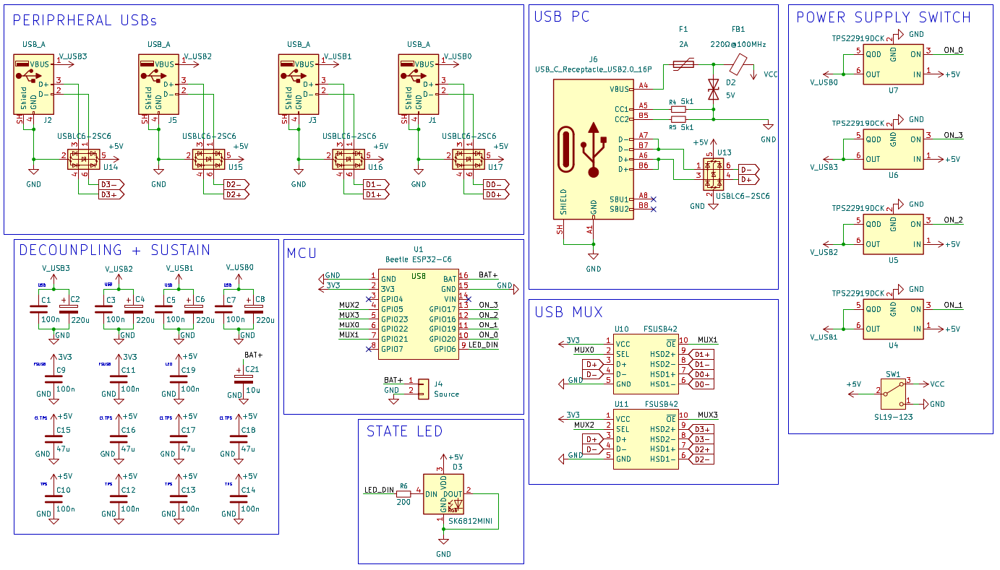

# USB REMOTE SWITCHER
USB hub with multiple USB-A inputs and one USB-C pc output. Active port is remotely chosen using remote communication between two esp32c6 boards.
# SCHEMATICS
The schematics for the hub board.

